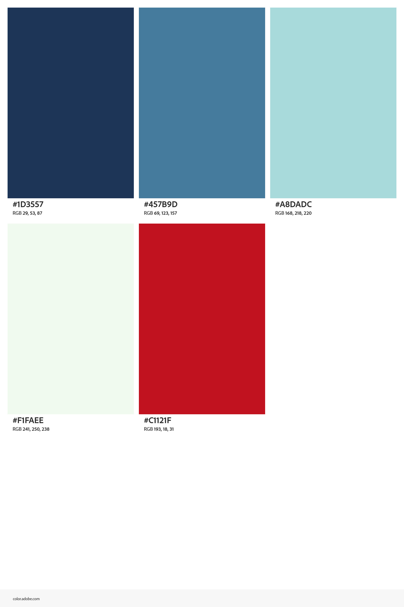
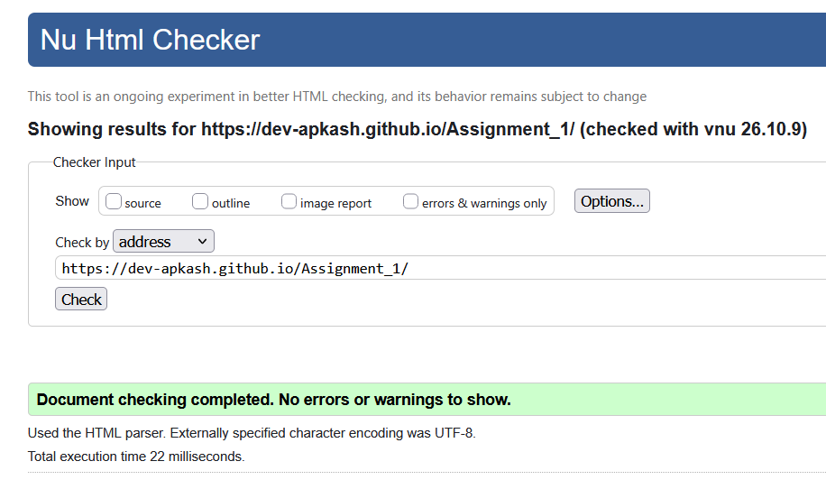
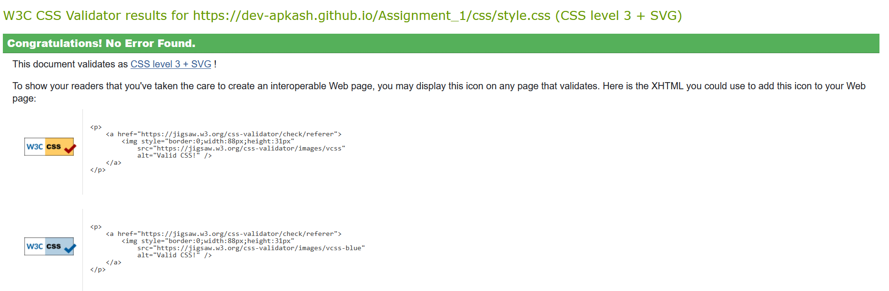
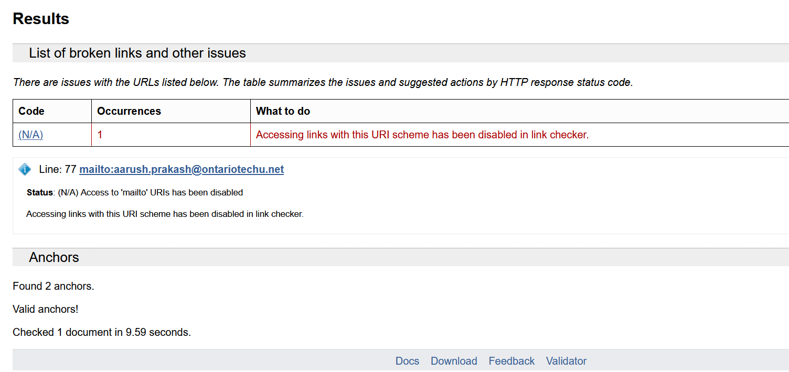
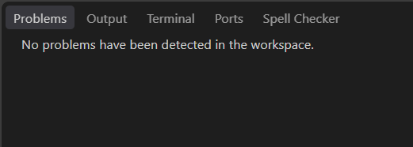
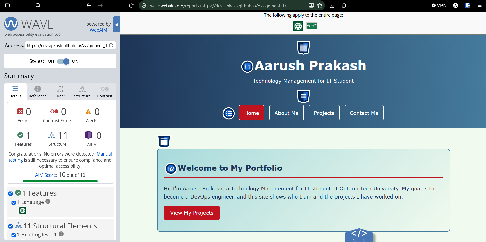
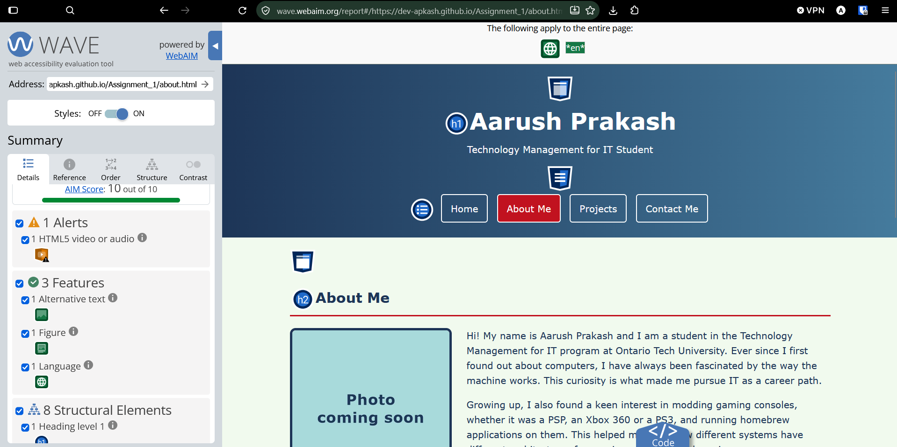
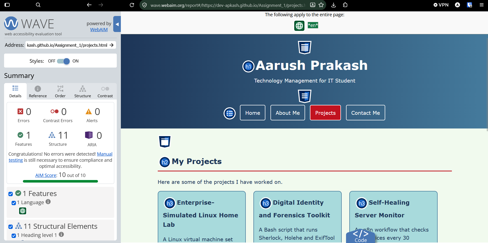
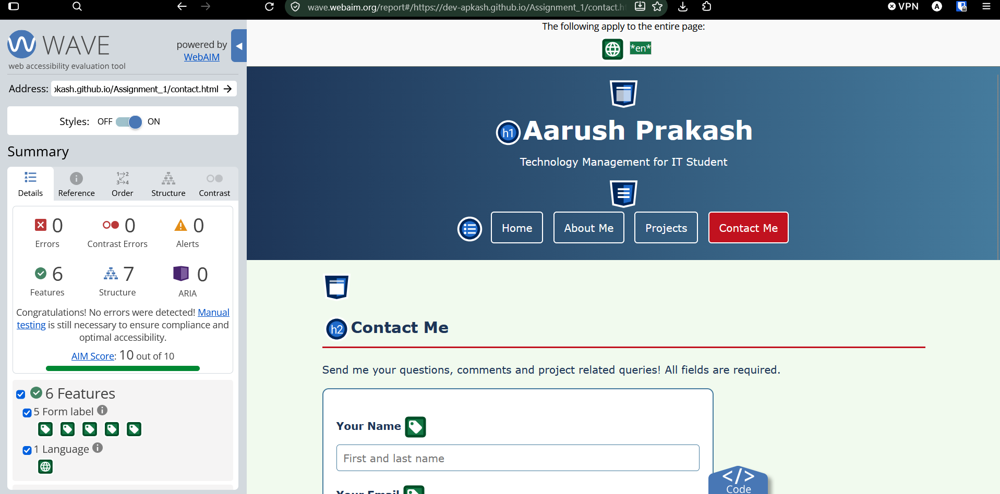

# Assignment 1 - Personal Portfolio Website

**Course:** INFR3120 - Web and Scripting Programming
**Student:** Aarush Prakash

- **Live site (GitHub Pages):** https://dev-apkash.github.io/Assignment_1/
- **Repository:** https://github.com/Dev-APkash/Assignment_1

A four page personal portfolio website built with HTML5 and CSS3 only (no JavaScript, no frameworks).

## Pages

| Page | File | Content |
|---|---|---|
| Home | `index.html` | Welcome section and links to the other pages |
| About Me | `about.html` | My photo, an introduction and my intro video (with poster and controls) |
| Projects | `projects.html` | My projects, each with a heading, a short description and a GitHub link |
| Contact Me | `contact.html` | Contact form with HTML5 validation |

Every page has the same header with navigation and the same footer with my email and copyright.

## File Structure

```
Assignment_1/
├── index.html
├── about.html
├── projects.html
├── contact.html
├── css/
│   ├── style.css    (colours, fonts and look shared by all screen sizes)
│   ├── mobile.css   (phone layout)
│   ├── tablet.css   (tablet layout)
│   └── laptop.css   (laptop and desktop layout)
├── images/
│   ├── profile.jpg  (my photo)
│   └── poster.jpg   (video poster image)
├── video/
│   └── intro.mp4    (my intro video)
└── README.md
```

## Semantic Tags

- `<header>` - my name and the navigation at the top of every page
- `<nav>` - the navigation links to all four pages
- `<main>` - the content that is different on each page
- `<section>` - groups each part of a page (intro, explore, about, video, projects, contact)
- `<article>` - each project on the Projects page
- `<figure>` and `<figcaption>` - my photo and its caption on the About Me page
- `<address>` - my contact email in the footer
- `<footer>` - email and copyright at the bottom of every page

## Responsive Design (Fluid Design and Media Queries)

**Fluid design:** widths are set in percentages instead of fixed pixels, for example `main` is 80% / 90% / 95% of the screen, the home and project boxes are 30% / 45% / 100%, and the photo, video and form inputs use `width: 100%` with a `max-width`.

**Media queries:** there is a separate CSS file for each viewport. They are linked in the `<head>` of every page with a `media` attribute, so each file is only used when the screen width matches:

```html
<link rel="stylesheet" href="css/mobile.css" media="only screen and (max-width: 480px)">
<link rel="stylesheet" href="css/tablet.css" media="only screen and (min-width: 481px) and (max-width: 960px)">
<link rel="stylesheet" href="css/laptop.css" media="only screen and (min-width: 961px)">
```

| Viewport | File | Dimensions | Layout |
|---|---|---|---|
| Mobile | `mobile.css` | 480px wide or smaller | One column, nav links stacked full width, smaller heading and photo |
| Tablet | `tablet.css` | 481px to 960px | Two boxes per row, photo floated left with text wrapping around it |
| Laptop | `laptop.css` | 961px or wider | Three boxes per row, page width limited to 1100px so lines are not too long |

**Why these dimensions:** they are the three standard viewport sizes from the Week 3 lecture.

- **480px and below** covers phones held upright. Most phones are between 360px and 430px wide, so one column is the easiest to read and the stacked nav links are big enough to tap with a finger.
- **481px to 960px** covers tablets such as the iPad Mini (768px) and iPad Air (820px), and small browser windows. There is enough room for two columns but not three.
- **961px and above** covers laptops and desktops. The laptop range starts at 961px instead of 960px so the tablet and laptop files never apply at the same time.

**No Flexbox or Grid is used.** Boxes are placed side by side with `display: inline-block` and `vertical-align: top`, the nav links use `inline-block`, and the photo on the About Me page uses `float: left` with a `clear` div after the text.

## Gradients

Both gradients are in `css/style.css`. Each one has a solid `background-color` as a fallback for older browsers, with the gradient set as the `background-image`.

| Type | Where | Code |
|---|---|---|
| Linear gradient | The header on all four pages | `linear-gradient(to right, #1D3557, #457B9D)` - navy on the left to steel blue on the right |
| Angled linear gradient | The welcome section (`#intro`) on the Home page | `linear-gradient(135deg, #A8DADC, #F1FAEE)` - aqua to off-white, diagonally from the top left corner to the bottom right |

## Colour Scheme

I created a five colour scheme in Adobe Color (https://color.adobe.com/create). The hex values are also written in a comment at the top of `css/style.css`.

| Colour | Hex | Used for |
|---|---|---|
| Navy | `#1D3557` | Header, footer, headings and main text |
| Steel Blue | `#457B9D` | Header gradient and borders |
| Aqua | `#A8DADC` | Home and project boxes, intro gradient and footer links |
| Off-White | `#F1FAEE` | Page background and intro gradient |
| Red | `#C1121F` | Buttons, heading underlines and the current page in the nav |

I picked dark navy and red against light aqua and off-white so the text has high contrast and passes the WAVE contrast check.



## Contact Form Validation

The form uses HTML5 validation only, so the browser checks the data before it is sent:

- **Name** - `required` and `minlength="2"`
- **Email** - `type="email"` checks that the value looks like an email address
- **Cell Number** - `type="tel"` with `pattern="[0-9]{3}-[0-9]{3}-[0-9]{4}"` (format 905-555-1234)
- **Comments** - `required` with `maxlength="500"`
- **What is 2 + 2?** - `type="number"` with `min="4"` and `max="4"`, so only 4 is accepted
- Every `<label>` uses `for` to match its input's `id` for accessibility

The form uses `action="mailto:..."` with `method="post"` and `enctype="text/plain"` (Week 2 lecture), which opens the visitor's email program with the form data. GitHub Pages cannot run server-side scripts like PHP, so a mailto form is used.

## Testing and Validation

| Test | Tool | Result |
|---|---|---|
| HTML | W3C Markup Validation Service (https://validator.w3.org/) | All 4 pages: 0 errors, 0 warnings |
| CSS | W3C CSS Validation Service (https://jigsaw.w3.org/css-validator/) | All 4 CSS files: 0 errors, 0 warnings |
| Links | W3C Link Checker (https://validator.w3.org/checklink) | _(add result)_ |
| Spelling | VS Code - Code Spell Checker (cSpell) extension | All HTML and CSS files: no spelling errors |
| Accessibility | WAVE (https://wave.webaim.org/) | All 4 pages: 0 errors, 0 contrast errors, AIM score 10/10 (see below) |

**WAVE results by page:**

| Page | Errors | Contrast Errors | Alerts |
|---|---|---|---|
| Home | 0 | 0 | 0 |
| About Me | 0 | 0 | 1 |
| Projects | 0 | 0 | 0 |
| Contact Me | 0 | 0 | 0 |

The one alert on the About Me page is "HTML5 video or audio". WAVE shows this alert on any page that has a video, to remind the developer to check for captions. It is not an error.










## Sources and Credits

- The HTML and CSS techniques (semantic tags, floats, fluid design, media queries, gradients, video, forms and validation) are from the INFR3120 course lectures (Weeks 1 to 4).
- Colour scheme created with Adobe Color: https://color.adobe.com/create
